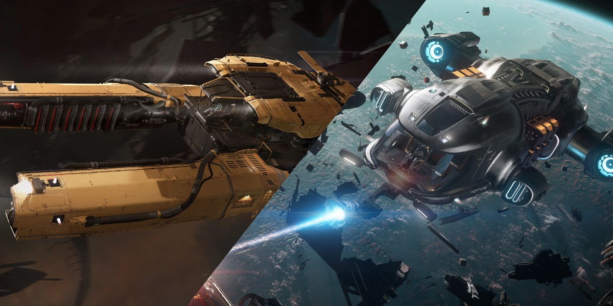
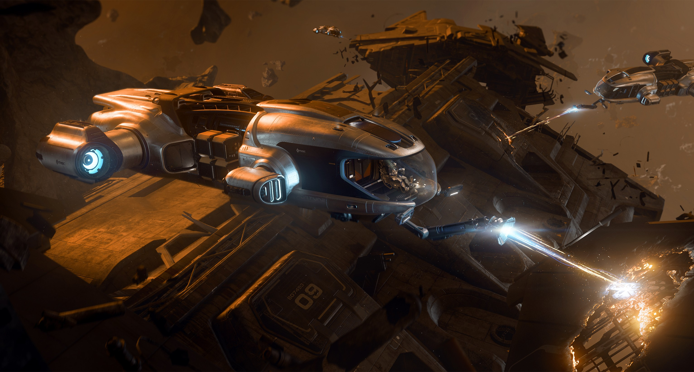
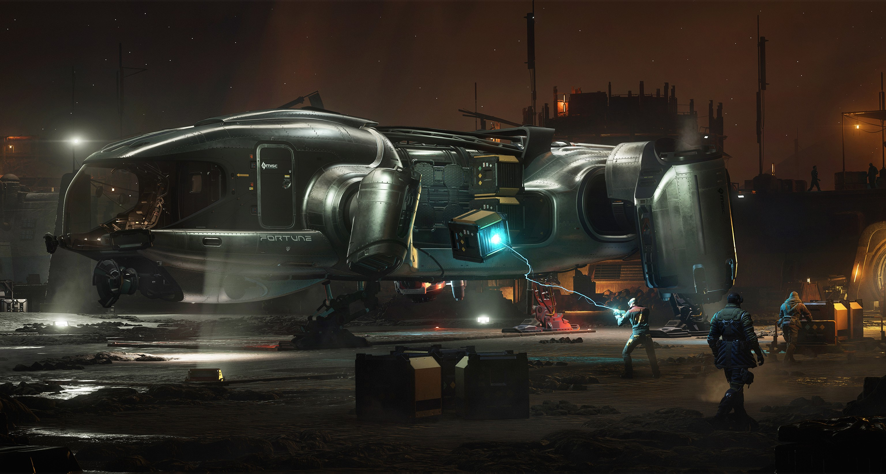
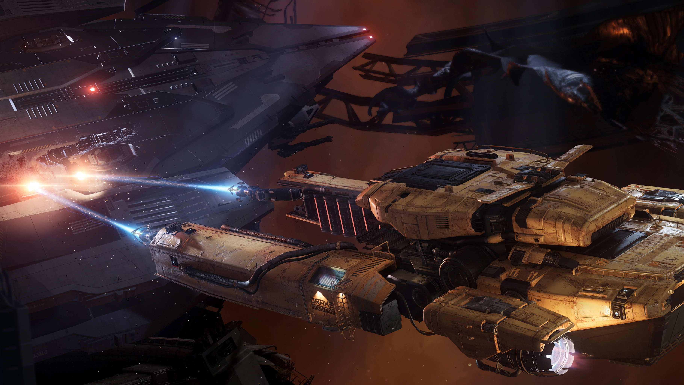

การเล่น Solo Salvage ด้วยการขูดสี (RMC - Recycled Material Composite) เป็นวิธีหาเงินในรูปแบบชิวๆ ที่ไม่ต้องเครียด เหมาะสำหรับผู้ที่ชอบเล่นคนเดียวและต้องการรายได้มั่นคง 💰

---

## เริ่มต้นอย่างไร: เลือกยานให้เหมาะกับสไตล์

### ยานที่แนะนำ

สามารถเริ่มต้นได้ด้วยยาน 2 รุ่นหลักคือ:

**🛒 สถานที่ซื้อ:** ดาว Hurston - Lorville - New Deal

| ยาน | ราคา | หัวขุด | พื้นที่จัดเก็บ |
|-----|------|--------|----------------|
| **MISC Fortune** | 1,890,000 aUEC | 1 หัว | 12 SCU ข้างยาน + 4 SCU ในยาน + 13 SCU ในเครื่อง |
| **Drake Vulture** | 2,646,000 aUEC | 2 หัว | 12 SCU ในยาน + 13 SCU ในเครื่อง |

> **💡 เคล็ดลับ:** หัวขุดแนะนำให้เปลี่ยนเป็น **Abrade** ราคา 21,250 aUEC ซึ่งจะต้องเข้าใกล้มากกว่า แต่แลกมาด้วยความเร็วในการขูดที่สูงขึ้น

---

## เปรียบเทียบ Fortune vs Vulture

### MISC Fortune 🚀

- ✅ **มีระบบจัดเก็บกล่องอัตโนมัติ** ไม่ต้องมาคอยดึงจากกล่องมาจัดเอง
- ✅ **มีความคล่องตัวคล่องแคล่วมากกว่า** บินง่าย จอดง่าย
- ⚠️ **มีหัวขุดแค่หัวเดียว** ทำให้ขูดช้ากว่า

### Drake Vulture 🦅

- ✅ **มีหัวขุด 2 หัว** ทำให้มีความเร็วและกำลังการขูดสียานมากกว่า Fortune เท่าตัว
- ⚠️ **ยานมีความคล่องตัวน้อยกว่า Fortune** ค่อนข้างหนัก
- ⚠️ **ต้องมาคอยจัดกล่องด้วยตัวเอง** ไม่มีระบบอัตโนมัติ

> **ความคิดเห็นส่วนตัว:** ผมชอบ Fortune มากกว่า Vulture เพราะระบบจัดกล่องอัตโนมัติทำให้ผมสามารถโฟกัสไปที่การขูดสี (RMC) อย่างเดียวได้ ไม่จำเป็นต้องเดินไปจัดกล่องเรื่อยๆ ซึ่งสะดวกสบายมากกว่า แลกกับการที่ขูดสี (RMC) ช้ากว่า Vulture แต่ถ้าเรามีเพื่อนช่วย Vulture ก็จะเหมาะสมกว่า Fortune

---

## ทำไมถึงแนะนำให้ขูดสี (RMC)?

การขูดสี (RMC) มีข้อดีหลายประการเมื่อเทียบกับการย่อยยาน:

- ✅ **ประหยัดพื้นที่** ได้มากกว่าการเก็บชิ้นส่วนย่อย
- ✅ **RMC ราคาสูงกว่า** ชิ้นส่วนย่อย
- ✅ **ขายได้เลย ไม่ต้องไปหลอม** สะดวกและรวดเร็ว

---

## หาซากอวกาศได้ที่ไหน?

### 1. เศษซากอวกาศ (Space Debris) 🌌

หาได้ตามสถานที่ต่างๆ เช่น:
- **สถานี Refinery** ต่างๆ เช่น CRU L1, ARC L2 เป็นต้น
- **แถบดาวเคราะห์น้อย** เช่นวงแหวนดาว Yela
- **Mining Sites** ต่างๆ รอบๆดาวเคราะห์หลัก

### 2. ภารกิจ Salvage ของ Stanton 📋

**ภารกิจถูกกฎหมาย (Legal)**: ต้องจ่ายค่า **FEE** เป็นธรรมเนียมเพื่อรับภารกิจ **ความเสี่ยงต่ำ** มีโอกาสเจอภัยคุกคามน้อยมาก

**ภารกิจผิดกฎหมาย (Illegal)** - มี 2 แบบ
1) **แบบซื้อสิทธิ์:** ต้องจ่ายค่า FEE เป็นธรรมเนียมเพื่อรับภารกิจ ไม่มีเงินรางวัล (แต่ได้ของไปขาย)
2) **แบบมีรางวัล:** จะได้รับเงินรางวัลเมื่อ Salvage เสร็จ แต่มีเวลาจำกัด 1 ชั่วโมง หากขูดสีไม่ทันเวลาที่กำหนดเควสจะล้มเหลว

### 3. ซากยานทั่วไป 🔍

ที่ไหนก็ได้ที่มีซากยาน สามารถลงมือขูดสีได้เลย!

---

## ประสบการณ์และความเห็นส่วนตัว

> **จาก @Sam | VSPC\TMST\ Stone-Dragon-2:**
> 
> ตามประสบการณ์ผม เวลาทำเควส Salvage ที่ถูกกฎหมายจะค่อนข้างปลอดภัย แทบไม่ค่อยเจออะไรมารบกวน แต่ถ้าเป็นเควสผิดกฎหมายละก็ ต้องระวังหน่อย เพราะมีโอกาสเจอยานศัตรูที่บินมาหาเรา โดยยานพวกนี้มักจะเป็นของกลุ่มที่ควบคุมพื้นที่นั้นๆ หรือไม่ก็พวก Salvage Investigator ที่เควสเรียกมา ส่วนว่ายานศัตรูที่มาจะเป็นฝ่ายกฎหมายหรือเปล่าก็ไม่รู้หรอก แล้วแต่โชค

---

## เริ่มต้นการ Salvage

การ Salvage สามารถเริ่มได้ 2 วิธี:

1. **รับเควส Salvage** จาก Contract Manager
2. **บินไปหายานที่เป็นซาก** แล้วเริ่มลงมือได้เลย

---

## สรุป: เริ่มต้นหาเงินแบบชิวๆ

การเล่น Solo Salvage เป็นอาชีพที่เหมาะสำหรับผู้ที่ชอบเล่นคนเดียว ไม่ต้องการความตื่นเต้นมากเกินไป แต่ต้องการรายได้มั่นคง เพียงแค่เลือกยานที่เหมาะกับสไตล์ของคุณ แล้วออกไปหาซากขูดสี ก็สามารถทำเงินได้อย่างต่อเนื่อง

ขอให้สนุกกับการ Salvage และโชคดีกับการหาซากมูลค่าสูงนะครับ! 🚀♻️

---

**เครดิต:** ข้อมูลและประสบการณ์จาก ***VSPC\TMST 3rd Aux Fleet***
